<!-- Animated terminal header. Edit scripts/make_header.py and re-run it to change the text. -->
<picture>
  <source media="(prefers-color-scheme: dark)" srcset="./assets/header-dark.svg">
  
</picture>

  
  <!-- Add your LinkedIn: replace YOUR-LINKEDIN and remove the comment markers.
  
  -->
  

I build software where **deterministic rules own the facts and AI handles the judgment calls**: accessibility audits that cite WCAG, a college platform where AI explains grades but never invents them, translation that runs privately in your browser. Currently a **software engineer at Academian** in Pune, India. Studied at SRM Institute of Science and Technology, Chennai.

### 🧭 Pick your path

<b>👔 Hiring? The 30-second version</b>

 

- **Ships end to end:** spec, tests, security review, deployment. [AccessLens](https://github.com/shashwat2120/AccessLens) is live with a REST API, web UI and MCP server.
- **Backend depth:** Java 25 + Spring Boot 4 + Spring Modulith ([Setu](https://github.com/shashwat2120/setu), [SkillSphere](https://github.com/shashwat2120/skillsphere)); Python + FastAPI ([AccessLens](https://github.com/shashwat2120/AccessLens)).
- **Applied AI, done carefully:** schema-validated LLM output, no tools for the model, prompt-injection defences, evaluation against a labelled corpus.
- **Interested in:** backend, AI products and accessibility engineering.

<b>🛠️ Developer? How I build</b>

 

1. **Write the spec first.** PRD, technical design and a security doc before code.
2. **Rules before models.** If a check can be deterministic, it is. AI only gets the ambiguous cases.
3. **Treat input as hostile.** Uploaded files are validated and parsed in a sandbox; LLM output is validated against a schema.
4. **Measure it.** Unit tests, property tests, and an eval suite with recall and precision targets.

<b>🤝 Want to collaborate?</b>

 

I'm happy to pair on **accessibility tooling**, **Indian-language tech** or **EdTech**. Open an issue on any repo below, or start a discussion there.

---

### 🚀 Featured work

<table>
  <tr>
    <td width="50%" valign="top">
      <h4><a href="https://github.com/shashwat2120/AccessLens">♿ AccessLens</a></h4>
      
Audits Word and PowerPoint files for accessibility issues and returns a prioritised fix list mapped to WCAG 2.2. 23 deterministic rules plus an LLM for judgment calls.

      

        
        
        
      

      <a href="https://accesslens-hdap.onrender.com"><b>▶ Try the live demo</b></a>
    </td>
    <td width="50%" valign="top">
      <h4><a href="https://github.com/shashwat2120/bharat-translate-plus">🇮🇳 Bharat Translate+</a></h4>
      
Chrome extension that translates <i>and simplifies</i> any web page into Hindi, Marathi, Tamil, Telugu, Kannada and Bengali, using Chrome's built-in AI. No server, no API key.

      

        
        
      

    </td>
  </tr>
  <tr>
    <td width="50%" valign="top">
      <h4><a href="https://github.com/shashwat2120/setu">🌉 Setu</a></h4>
      
A college operating system: student information, LMS and an AI student-success engine. PostgreSQL is the source of truth; AI explains and recommends but never invents an academic record.

      

        
        
        
      

    </td>
    <td width="50%" valign="top">
      <h4><a href="https://github.com/shashwat2120/skillsphere">🧩 SkillSphere</a></h4>
      
A learning platform where every claim about what someone knows comes with proof that can be checked.

      

        
        
        
      

    </td>
  </tr>
</table>

<b>📦 More projects</b>

 

| Project | What it does | Stack |
|---|---|---|
| [ReviewPulse AI](https://github.com/shashwat2120/pulseAI-review) | Agentic pipeline that turns daily Play Store reviews into a rolling 30-day trend report, merging near-duplicate topics | Python, LLM agents |
| [Music Recognition](https://github.com/shashwat2120/Enhanced-Music-Recognition-App) · [demo](https://enhanced-music-recognition-app.vercel.app) | Identifies songs from the mic or a file using audio fingerprinting plus Shazam, including Indian songs | Python, Streamlit |
| [Object Detection](https://github.com/shashwat2120/obeject-detection-ml-app) | Android app for object detection | Kotlin, ML |
| [Price Comparison Scraper](https://github.com/shashwat2120/E-commerce-Price-Comparison-Scraper-) | Compares product prices across online stores | Python, web scraping |
| [Crop Yield](https://github.com/shashwat2120/crop-yield-app) | Web app for crop yield prediction | React |

---

### 🛠️ Toolbox

  

---

### 📊 Activity

<!-- Stats card and snake are built daily by .github/workflows/snake.yml (no third-party stats service). -->

  <picture>
    <source media="(prefers-color-scheme: dark)" srcset="https://raw.githubusercontent.com/shashwat2120/shashwat2120/output/stats-dark.svg">
    
  </picture>

  <picture>
    <source media="(prefers-color-scheme: dark)" srcset="https://streak-stats.demolab.com/?user=shashwat2120&theme=github-dark-blue&hide_border=true&background=0d1117">
    
  </picture>

  <picture>
    <source media="(prefers-color-scheme: dark)" srcset="https://raw.githubusercontent.com/shashwat2120/shashwat2120/output/github-snake-dark.svg">
    
  </picture>

Rules for facts · AI for judgment · Tests for everything

